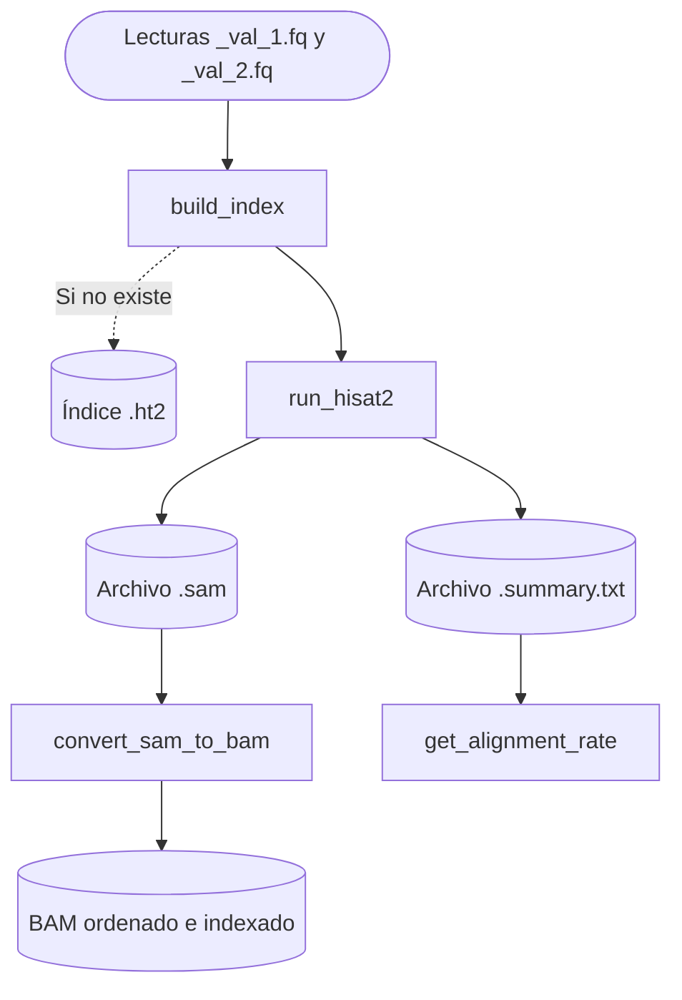

# Módulo de alineamiento de lecturas de RNA-seq (`align_reads.py`)

## Resumen 

Este módulo toma las lecturas limpias generadas por `qc_trimming.py` y las alinea contra el genoma de referencia de *Anopheles gambiae* usando **HISAT2**. Posteriormente, convierte los alineamientos a formato BAM ordenado e indexado con **samtools**, y evalúa la calidad del alineamiento por muestra.

## Requisitos 
- Python 3.12 
- **HISAT2** 
- **samtools**

## Estructura de archivos generados 


## Pipeline 



## Componentes clave 

- build_index(fasta_path, index_prefix, threads, gtf_path): Construye el índice de HISAT2. Si el archivo .1.ht2 ya existe, omite el proceso para ahorrar tiempo. Si se le pasa un GTF, extrae los sitios de empalme y exones.

- run_hisat2(fwd, rev, index_prefix, output_sam, summary_file, threads): Ejecuta HISAT2 en modo paired-end (-1 y -2). Guarda el alineamiento en formato SAM y el resumen de métricas en un .txt.

- convert_sam_to_bam(sam_path, bam_path, threads): Usa samtools sort para generar un BAM ordenado, samtools index para crear el .bai, y elimina el archivo SAM temporal para no saturar el disco.

- get_alignment_rate(summary_dir, suffix, umbral): Lee los resúmenes de HISAT2 con una expresión regular, extrae la tasa de alineamiento global y lanza un logger.warning si está por debajo del umbral (default: 70%).

## Uso por línea de comandos 

## Ejemplos 

1. Ejecución con GTF para construir el índice desde cero

```bash
python src/align_reads.py -r data/genome/genome_Anopheles_gambiae.fasta -i data/index/hisat2/genome -gtf data/genome/genome_Anopheles_gambiae.gtf -v
```
