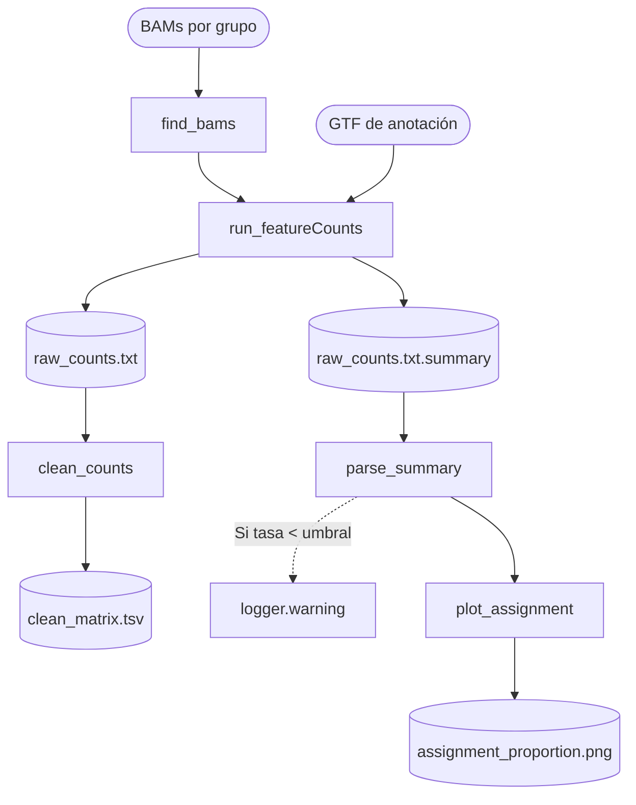

# Módulo de Conteo de Lecturas (`count_features.py`)

## Resumen 

Este módulo automatiza la creación de la matriz de conteos de expresión génica a partir de los archivos BAM generados por el módulo de alineamiento (`align_reads.py`). Utiliza **featureCounts** (del paquete Subread) para asignar las lecturas a los genes basándose en un archivo de anotación GTF. Posteriormente, limpia la matriz resultante, evalúa la calidad de la asignación por muestra y genera una gráfica del porcentaje de lecturas asignadas por muestra. 

## Requisitos

-   Python 3.12.
-   **Subread** (proporciona el comando `featureCounts`.     
-   Librerías de Python: `pandas`, `matplotlib`.    
-   Archivos BAM ordenados e indexados (`data/aligned/<grupo>/*.bam`).
-   Archivo GTF de anotación (generado por `download_data.py`).

## Estructura de los archivos generados 

```text
├── data
│   ├── counts
│   │   ├── clean
│   │   │   └── clean_matrix.tsv
│   │   ├── raw_counts.txt
│   │   └── raw_counts.txt.summary
├── logs
│   ├── feature_counts.log
├── results
│   └── images
│       ├── assignment_proportion.png
```
## Pipeline


## Componentes clave 

-   **`find_bams(data_dir, grupo)`**: Busca y retorna una lista con las rutas absolutas de todos los archivos `.bam` dentro de la carpeta de un grupo específico (ej. `data/aligned/resistant/`). Lanza un error si la carpeta o los archivos no existen.
    
-   **`run_featureCounts(bam_files, gtf_path, output_file, workers, strand)`**: Ejecuta la herramienta `featureCounts` usando `subprocess`. Utiliza los parámetros acordados en el diseño (`-p` para paired-end, `-C`, `-t exon`, `-g gene_id`). Genera la matriz cruda y su archivo `.summary`.
    
-   **`parse_summary(summary_file, umbral)`**: Lee el archivo `.summary` generado por `featureCounts`, calcula el porcentaje de lecturas asignadas por muestra y lanza un `logger.warning` si alguna muestra cae por debajo del umbral establecido (70% por defecto).
    
-   **`clean_counts(raw_counts_file, outdir)`**: Procesa la matriz cruda con `pandas`. Elimina las columnas de coordenadas (`Chr`, `Start`, `End`, `Strand`, `Length`), normaliza los nombres de las columnas (quitando las rutas y el `.bam`) y guarda una matriz limpia de *genes × muestras*.
    
-   **`plot_assignment(assignment_rates, outdir, umbral)`**: Genera un gráfico de barras con el porcentaje de asignación de cada muestra. Las barras que no superan el umbral se pintan de naranja y las que sí, de verde.

## Uso por línea de comandos

**Argumentos**

| Argumento          | Requerido | Default                 | Descripción                               |
|--------------------|-----------|-------------------------|-------------------------------------------|
| -d, --data_dir     | No        | data/aligned/           | Directorio raíz con los BAM por condición |
| -gtf, --annotation | No        | data/genome/...gtf      | Ruta al archivo de anotación GTF          |
| -c1, --condition1  | No        | resistant               | Grupo 1 de los datos de expresión         |
| -c2, --condition2  | No        | susceptible             | Grupo 2 de los datos de expresión         |
| -o, --outdir       | No        | data/counts/            | Directorio de salida                      |
| -w, --workers      | No        | 6                       | Número de hilos para featureCounts        |
| -u, --umbral       | No        | 70.0                    | Umbral mínimo de asignación (%)           |
| -v, --verbose      | No        | False                   | Muestra mensajes DEBUG                    |
| -g, --graphic      | No        | True                    | Incluye el gráfico de asignación          |
| --log_file         | No        | logs/feature_counts.log | Ruta del archivo de log                   |

**Ejemplos de ejecución**

1.  Ejecución básica (usando todas las rutas por defecto):

```bash
python src/count_features.py -v
```

2.  Ejecución personalizando las condiciones y el GTF:
    
```bash
python src/count_features.py -c1 control -c2 tratado -gtf data/genome/....gtf
```