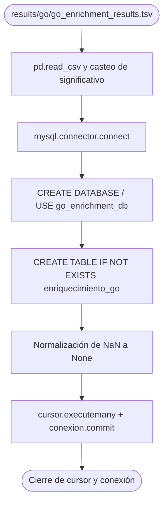

# Módulo de carga de enriquecimiento funcional a MySQL (`<nombre_del_script>.py`)

## Resumen 

Este módulo lee los resultados de enriquecimiento funcional generados por `functional_annotation.py` (`results/go/go_enrichment_results.tsv`) y los carga en una base de datos relacional en **MySQL** utilizando `pandas` y `mysql-connector-python`.

El módulo realiza lo siguiente:

1. Lee el archivo TSV de resultados de enriquecimiento GO y normaliza la columna `significativo` a valores enteros (`0` o `1`) compatibles con columnas booleanas en MySQL.
2. Establece conexión con el servidor MySQL usando los parámetros de acceso proporcionados por línea de comandos.
3. Crea la base de datos `go_enrichment_db` (con codificación `utf8mb4` y cotejamiento `utf8mb4_unicode_ci`) y la tabla `enriquecimiento_go` con índices en `grupo`, `go_id` y `significativo` si aún no existen.
4. Convierte los valores faltantes (`NaN`) a `None` e inserta todos los registros en lote mediante `executemany`, confirmando la transacción y cerrando el cursor y la conexión.

## Requisitos 
- Python 3
- **pandas** (`pd`)
- **mysql-connector-python** (`mysql.connector`)
- Servidor **MySQL** accesible con permisos para crear bases de datos y tablas
- Archivo de entrada `results/go/go_enrichment_results.tsv` generado previamente por `functional_annotation.py`

**Se recomienda ejecutar desde la raíz del proyecto, ya que la ruta del archivo de entrada es relativa (`results/go/go_enrichment_results.tsv`).**

## Estructura de datos y base de datos generada 
```text
analisis_expresion_malaria/
└── results/
    └── go/
        └── go_enrichment_results.tsv    # Entrada leída por crear_base()

MySQL Server:
└── go_enrichment_db
    └── enriquecimiento_go              # Tabla con PK `id` e índices en grupo, go_id y significativo
```

## Flujo de ejecución 


## Componentes clave 

### Carga y creación de esquema en MySQL

- `crear_base(host, user, password) -> None`: Lee `results/go/go_enrichment_results.tsv`, convierte `significativo` a entero (`0`/`1`), crea `go_enrichment_db` y la tabla `enriquecimiento_go`, reemplaza valores `NaN` por `None`, inserta los registros en lote con `executemany` e imprime el total de filas insertadas (`cursor.rowcount`).

### Argumentos y punto de entrada

- `my_parser() -> ap.Namespace`: Configura `argparse` para recibir los parámetros de conexión a MySQL (`-H`/`--host`, `-u`/`--user` y `-p`/`--password`).

- `main()`: Obtiene los argumentos mediante `my_parser()` e invoca `crear_base(args.host, args.user, args.password)`.

## Uso por línea de comandos 

### Argumentos

| Argumento | Requerido | Default | Descripción |
| --- | --- | --- | --- |
| -H, --host | Sí | — | ID o dirección del host de MySQL |
| -u, --user | Sí | — | Nombre de usuario de MySQL |
| -p, --password | Sí | — | Contraseña del usuario de MySQL |

## Ejemplos 

1. Cargar los resultados de enriquecimiento GO en un servidor MySQL local

```bash
python <ruta_del_script>.py -H localhost -u <usuario> -p <contraseña>
```