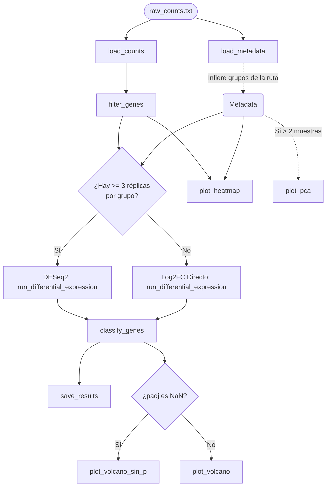

# Módulo de Expresión Diferencial (`differential_expression.py`)

## Resumen

Este módulo realiza el análisis de expresión diferencial entre los grupos `resistant` y `susceptible` a partir de la matriz de conteos generada por `featureCounts`. 

El módulo es **flexible**: detecta automáticamente cuántas réplicas biológicas hay. Si cuenta con 3 o más muestras por grupo, utiliza **InMoose (DESeq2)** para calcular p-valores ajustados. Si solo cuenta con 2 muestras (n=1 por grupo), calcula el `log2FoldChange` directamente a partir de datos normalizados (log2(CPM+1)). Finalmente, clasifica los genes, guarda los resultados y genera gráficos de alta calidad (PCA, Volcano Plot y Heatmap) adaptados a la cantidad de datos disponibles.

El módulo realiza lo siguiente

1. Lee y limpia la matriz cruda de `featureCounts`, eliminando columnas de anotación genómica y sufijos `.bam` para obtener una tabla `genes × muestras`.
2. Deduce la condición experimental (`resistant` o `susceptible`) de cada muestra a partir de la carpeta de su archivo BAM en el encabezado de `featureCounts` (o mediante una tabla externa indicada con `--metadata`).
3. Filtra los genes de baja expresión (10 conteos en al menos 2 muestras, o en al menos 1 muestra si el experimento tiene 2 muestras en total).
4. Ejecuta el análisis de expresión diferencial con InMoose (`DESeq2`) cuando existen 3 réplicas por condición, o calcula el `log2FoldChange` exploratorio sobre log_2(CPM + 1) cuando no hay réplicas suficientes.
5. Clasifica cada gen en `up_resistant`, `up_susceptible` o `ns` usando `padj < 0.05` y log_2FoldChange 1.0 (o únicamente log_2FoldChange 1.0 cuando `padj` es `NaN`).
6. Guarda en disco la tabla completa, las listas de genes por categoría y las figuras correspondientes (`PCA`, `Volcano plot` y `Heatmap`).

## Requisitos
- Python 3.12
- Librerías de Python: `inmoose`, `pandas`, `numpy`, `matplotlib`, `scikit-learn`, `seaborn`
- Matriz cruda generada por `featureCounts` (idealmente `data/counts/raw_counts.txt`).

## Estructura de archivos generados
```text
analisis_expresion_malaria/
├── results/
│   ├── exp_dif/
│   │   ├── resultados_completos.csv        # Tabla con todos los genes y su categoría
│   │   ├── up_resistant.txt                # Lista de genes sobreexpresados en resistentes
│   │   └── up_susceptible.txt              # Lista de genes sobreexpresados en susceptibles
│   └── images/
│       ├── pca.png                         # (Solo si hay >= 3 muestras totales)
│       ├── volcano.png                     # (Si hubo p-valores / DESeq2)
│       ├── volcano_sin_p.png               # (Si no hubo réplicas / solo log2FC)
│       └── heatmap.png                     # Top 25 genes up y 25 down (Z-score)
└── logs/
    └── differential_expression.log         # Archivo de registro
```

## Pipeline


## Componentes clave

### Carga, metadatos y filtrado de matriz

`load_counts(ruta_matriz)`: Lee y limpia la matriz de featureCounts, eliminando columnas de coordenadas para quedarse con una matriz de genes × muestras.

`infer_conditions(ruta_matriz)` / `load_metadata(matriz_conteos, ruta_matriz, metadata_path, condition1, condition2)`: Deduce el grupo experimental (resistant/susceptible) leyendo la ruta del archivo BAM original en el encabezado de featureCounts o mediante un archivo externo (--metadata).

`filter_genes(matriz_conteos)`: Elimina genes de baja expresión conservando aquellos con 10 conteos en al menos 2 muestras (o en al menos 1 muestra si el experimento tiene ≤ 2 muestras en total), registrando el conteo en el log.

### Análisis diferencial y clasificación

`run_differential_expression(matriz_filtrada, meta)`: Función central. Evalúa el número de muestras. Si hay réplicas suficientes, ejecuta DESeq2. Si no, aplica una normalización CPM y un logaritmo para calcular el log2FoldChange directo.

`classify_genes(df_res)`: Etiqueta cada gen como up_resistant, up_susceptible o ns. Si existen p-valores, filtra por padj < 0.05 y |log2FC| >= 1.0. Si no existen, filtra solo por |log2FC| >= 1.0.

`save_results(df_clasificado, outdir)`: Exporta la tabla completa (resultados_completos.csv) y guarda las listas de genes diferenciales en up_resistant.txt y up_susceptible.txt.

### Visualización de resultados

`plot_pca(matriz_filtrada, meta, outdir)`: Genera un Análisis de Componentes Principales (si hay >2 muestras) para visualizar la varianza entre grupos.

`plot_volcano(df_clasificado, outdir, condition1, condition2)` / `plot_volcano_sin_p(df_raise, outdir, condition1, condition2)`: Genera gráficos de dispersión (Volcano plots). El primero usa los p-valores de DESeq2; el segundo adapta el eje Y a la expresión promedio cuando no hay estadística inferencial.

`plot_heatmap(matriz_filtrada, df_clasificado, outdir, top_n=25)`: Genera un Mapa de Calor (con Seaborn) de los Top N genes diferenciales. Aplica un Z-score por gen para comparar visualmente patrones de expresión (rojo = alto, azul = bajo).

## Uso por línea de comandos

### Argumentos

| Argumento | Requerido | Default | Descripción |
| --- | --- | --- | --- |
| -m, --matrix | No | data/counts/raw_counts.txt | Ruta a la matriz de conteos cruda |
| -md, --metadata | No | None | Archivo con columnas sample y condition (opcional) |
| -o, --outdir | No | results/exp_dif | Directorio de salida de las tablas |
| -c1, --condition1 | No | resistant | Condición de prueba (grupo de interés) |
| -c2, --condition2 | No | susceptible | Condición de referencia (grupo base) |
| -pca, --pcaplot | No | True | Genera el PCA (usa --no-pcaplot para omitir) |
| -vol, --volcanoplot | No | True | Genera el Volcano Plot (usa --no-volcanoplot para omitir) |
| -hm, --heatmap | No | True | Genera el Heatmap (usa --no-heatmap para omitir) |
| -tn, --top_genes | No | 25 | Número de genes Top (up/down) a graficar en el Heatmap |
| -v, --verbose | No | False | Muestra mensajes DEBUG |
| --log_file | No | logs/differential_expression.log | Ruta del archivo de log |

## Ejemplos

Ejecución básica (detecta automáticamente si usar DESeq2 o log2FC directo):
```bash
python src/differential_expression.py -v
```

Ejecución personalizando el número de genes para el Heatmap (ej. Top 50):
```bash
python src/differential_expression.py -tn 50 -v
```
