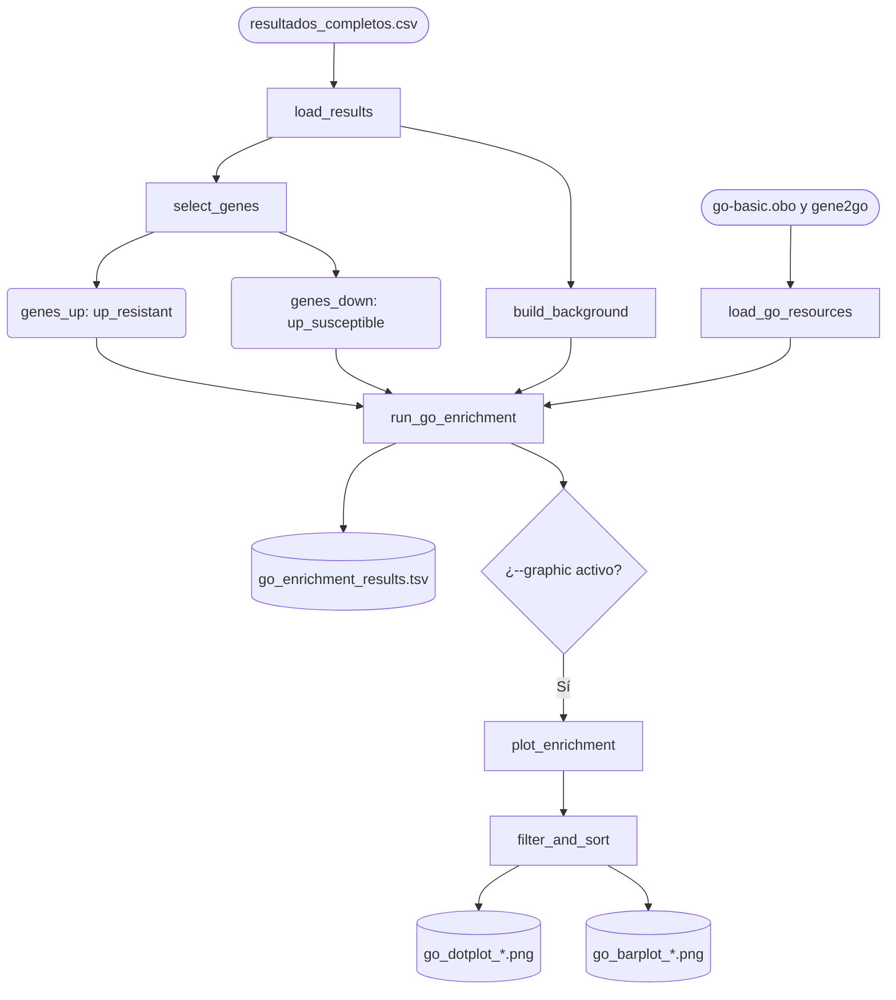

# Módulo de anotación funcional y enriquecimiento de Gene Ontology (`functional_annotation.py`)

## Resumen

Este módulo toma la tabla de resultados de expresión diferencial generada por `differential_expression.py`
y realiza un análisis de sobrerrepresentación funcional (**ORA**) mediante **Gene Ontology (GO)** para los
genes diferenciales entre cepas resistentes y susceptibles de *Anopheles gambiae*. Posteriormente, exporta
una tabla unificada con los términos enriquecidos y genera gráficos de apoyo (`dotplot` y `barplot`) por
cada condición experimental.

El módulo realiza lo siguiente:

1. Lee la tabla de expresión diferencial y separa los genes en sobreexpresados (up_resistant) y subexpresados (up_susceptible) según los umbrales de padj y log_2FoldChange.
2. Carga la estructura jerárquica de Gene Ontology (go-basic.obo) y las asociaciones gen -> GO del organismo filtradas por taxid (7165 para Anopheles gambiae).
3. Construye el conjunto de fondo (universo estadístico) utilizando todos los genes expresados evaluados en el análisis diferencial.
4. Ejecuta la prueba exacta de Fisher de una cola con propagación jerárquica (True Path Rule) y corrección por pruebas múltiples (fdr_bh o bonferroni) de manera independiente para up_resistant y up_susceptible en los aspectos seleccionados (BP, MF, CC), emitiendo una advertencia en el registro si alguna lista tiene menos de 3 genes anotados.
5. Consolida los términos sobrerrepresentados en una tabla TSV y, si la opción --graphic está activa, genera gráficas dotplot y barplot con los términos principales de cada grupo.

## Requisitos

- Python 3.12
- Librerías de Python: `goatools`, `pandas`, `numpy` y `matplotlib`
- Tabla de resultados de expresión diferencial (`results/exp_dif/resultados_completos.csv`)
- Archivo de ontología acíclica `go-basic.obo` (`data/go/go-basic.obo`)
- Archivo de asociaciones gen -> GO (`data/go/gene2go`)

**Se recomienda ejecutar desde la raíz del proyecto, ya que las rutas por defecto son relativas (`data/`, `results/`, `logs/`)**

## Estructura de archivos generados
```text
analisis_expresion_malaria/
├── results/
│   └── go/
│       ├── go_enrichment_results.tsv          # Tabla unificada de términos GO enriquecidos
│       ├── go_dotplot_up_resistant.png        # Dot plot de términos en cepa resistente (si -g)
│       ├── go_barplot_up_resistant.png        # Bar plot de términos en cepa resistente (si -g)
│       ├── go_dotplot_up_susceptible.png      # Dot plot de términos en cepa susceptible (si -g)
│       └── go_barplot_up_susceptible.png      # Bar plot de términos en cepa susceptible (si -g)
└── logs/
    └── go_enrichment.log                      # Archivo de registro de ejecución
```

## Pipeline


## Componentes clave

### Carga de datos y definición de conjuntos

- `load_results(ruta_resultados)`: Verifica la existencia de la tabla de expresión diferencial y la carga en un `DataFrame` indexado
    por identificador de gen.
- `select_genes(df_res, lfc_umbral=1.0, padj_umbral=0.05)`: Extrae las listas `genes_up` y `genes_down`. Si existen valores válidos
    de `padj`, filtra con `padj < 0.05` y log_2FoldChange 1.0; en
    ausencia de `padj` (análisis sin réplicas), filtra únicamente con log_2FoldChange 1.0.
- `load_go_resources(obo_path, gene2go_path, taxid)`: Carga el grafo acíclico dirigido (`GODag`) desde `go-basic.obo` y lee las
    anotaciones funcionales mediante `Gene2GoReader`, devolviendo un diccionario separado por aspecto (`BP`, `MF`, `CC`).
- `build_background(df_res)`: Define el universo de fondo como el conjunto (`set`) de todos los genes expresados presentes en la
    tabla de expresión diferencial.

### Análisis de enriquecimiento funcional

- `run_go_enrichment(genes_estudio, background, godag, gene2gos, nombre_lista, alpha, method, aspectos)` — ejecuta el contraste estadístico
    para cada grupo experimental mediante los siguientes pasos:
  1. Filtra las asociaciones según los aspectos de GO seleccionados (`BP`, `MF`, `CC`) e intersecta tanto el universo como la lista de
     estudio contra los genes con anotación válida, reportando en el log cuántos genes quedaron sin equivalencia o anotación.
  2. Si la lista anotada tiene menos de 3 genes, emite un `logger.warning` y devuelve un `DataFrame` vacío sin interrumpir el flujo.
  3. Ejecuta `GOEnrichmentStudyNS` con propagación jerárquica (`propagate_counts=True`), conserva únicamente términos sobrerrepresentados
     (`enrichment == 'e'`) y devuelve un `DataFrame` ordenado por `padj` y `p_value`.

### Visualización de resultados

- `filter_and_sort(df_go, grupo, top_n=10)`: Filtra los registros de un grupo experimental; prioriza términos significativos
   (`significativo == True`) o, en su defecto, conserva los primeros `top_n` términos ordenados por `padj` invertidos para su lectura de arriba hacia abajo.
- `dotplot(df_top, grupo, outdir)`: Genera un gráfico de dispersión (`go_dotplot_<grupo>.png`) donde el eje X representa `gene_ratio`, el tamaño del punto      escala con `k_estudio` y el color mapea `padj`.
- `barplot(df_top, grupo, outdir)`: Genera un gráfico de barras horizontales (`go_barplot_<grupo>.png`) con el conteo de genes (`k_estudio`) en el eje X y el valor de `padj` codificado por color.
- `plot_enrichment(df_go, outdir, top_n=10)`: Coordina la generación de ambos gráficos (`dotplot` y `barplot`) para cada grupo presente en la tabla final.

## Uso por línea de comandos

### Argumentos

| Argumento | Requerido | Default | Descripción |
| --- | --- | --- | --- |
| `-w`, `--workdir` | No | `.` | Directorio raíz del proyecto desde donde se resuelven rutas relativas |
| `-i`, `--input` | No | `results/exp_dif/resultados_completos.csv` | Ruta a la tabla de resultados de expresión diferencial |
| `--obo` | No | `data/go/go-basic.obo` | Ruta al archivo de ontología `go-basic.obo` |
| `--annotation` | No | `data/go/gene2go` | Ruta al archivo de anotación gen -> GO |
| `-o`, `--outdir` | No | `results/go` | Directorio de salida para la tabla TSV y las gráficas |
| `-t`, `--taxid` | No | `7165` | Identificador taxonómico de NCBI (*Anopheles gambiae*) |
| `--pvalue` | No | `0.05` | Umbral de significancia para el p-valor ajustado (`padj`) |
| `--method` | No | `fdr_bh` | Método de corrección por pruebas múltiples (`fdr_bh` o `bonferroni`) |
| `--aspectos` | No | `BP MF CC` | Aspectos de Gene Ontology a evaluar (`BP`, `MF`, `CC`) |
| `-g`, `--graphic` | No | `True` | Genera gráficas de enriquecimiento (usa `--no-graphic` para omitirlas) |
| `--top-n` | No | `10` | Número máximo de términos GO a mostrar por gráfica |
| `-v`, `--verbose` | No | `False` | Muestra mensajes `DEBUG` en consola |
| `--log_file` | No | `logs/go_enrichment.log` | Ruta para guardar el archivo de log |

## Ejemplos

1. Ejecución básica desde la raíz del proyecto con parámetros por defecto

```bash
python src/functional_annotation.py -v
```

2. Ejecución evaluando únicamente Proceso Biológico (`BP`) y Función Molecular (`MF`), mostrando los Top 15 términos en las gráficas

```bash
python src/functional_annotation.py --aspectos BP MF --top-n 15 -v
```

3. Ejecución sin generar gráficas y ajustando el umbral de significancia

```bash
python src/functional_annotation.py --pvalue 0.10 --no-graphic -v