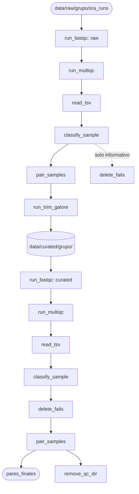

# Pipeline de control de calidad y trimming de lecturas

## Resumen

Este módulo automatiza el control de calidad y la limpieza de las lecturas paired-end de *Anopheles gambiae* de los grupos `resistant` y `susceptible`, previamente descargadas con `download_data.py`.

El módulo realiza lo siguiente:

1. Corre **FastQC** y **MultiQC** sobre las lecturas crudas (solo diagnóstico, no se descarta nada).
2. Clasifica cada muestra como `pass`, `warn` o `fail` a partir de los módulos de FastQC definidos en `OVERALL_FLAGS`.
3. Empareja las lecturas `_1` y `_2` por SRR y conserva solo los pares completos.
4. Recorta adaptadores y bases de baja calidad con **Trim Galore** (modo `--paired`).
5. Vuelve a correr FastQC y MultiQC sobre las lecturas recortadas y las clasifica.
6. Elimina de la lista de análisis las muestras con `fail` y conserva solo los pares completos, que son los que entran al análisis.

**Todas las acciones se registran con marcas de tiempo en un archivo de log.**

## Requisitos

- Python 3.12
- FastQC y Trim Galore (con Cutadapt) disponibles en el `PATH`
- `multiqc` y `pandas`
- Lecturas crudas en `data/raw/<grupo>/sra_runs/` con nombres `<SRR>_1.fastq` y `<SRR>_2.fastq` (por ejemplo, las que genera `download_data.py`)

**Se recomienda ejecutar desde la raíz del proyecto, ya que las rutas de entrada (`data/raw/`) son relativas.**
**Ejecútese después del módulo `download_data.py`.**

## Estructura de archivos generados

```text
analisis_expresion_malaria/
├── data/
│ ├── raw/<grupo>/sra_runs/            # Entrada: FASTQ crudos
│ └── curated/<grupo>/
│   ├── <SRR>_val_1.fq                 # Lecturas recortadas (mate 1)
│   └── <SRR>_val_2.fq                 # Lecturas recortadas (mate 2)
├── results/
│ ├── fastqc/
│ │ ├── raw/<grupo>/                   # Reportes de FastQC (crudas)
│ │ └── curated/<grupo>/               # Reportes de FastQC (recortadas)
│ └── qc/                              # Reportes de MultiQC (temporal, se elimina al final)
└── logs/
  └── qc_trimming.log
```

## Pipeline



## Constantes

| Constante | Valor | Descripción |
|---|---|---|
| `GRUPOS` | `["resistant", "susceptible"]` | Grupos de expresión que se procesan |
| `CURATED_DIR` | `data/curated` | Directorio de salida de las lecturas recortadas |
| `FASTQ_SUFFIX_FWD` / `FASTQ_SUFFIX_REV` | `_1.fastq` / `_2.fastq` | Sufijos de las lecturas crudas |
| `FASTQC_FLAG_COLUMNS` | 10 módulos de FastQC | Banderas que se guardan por muestra |
| `OVERALL_FLAGS` | `adapter_content`, `per_base_n_content` | Módulos que deciden el `pass`/`warn`/`fail` de una muestra |
| `TRIM_QUALITY` | `20` | Calidad Phred mínima para recortar el extremo 3' |
| `TRIM_MIN_LENGTH` | `36` | Longitud mínima de lectura tras el recorte |

## Componentes clave

### FastQC y MultiQC

`run_fastqc(w=4, outdir="results", stage="raw")` — corre FastQC sobre los FASTQ de cada grupo y deja los reportes en `<outdir>/fastqc/<stage>/<grupo>/`.

- Con `stage="raw"` lee `data/raw/<grupo>/sra_runs/*.fastq*`.
- Con cualquier otro `stage` (se usa `"curated"`) lee `data/curated/<grupo>/*_val_*.fq`.
- Lanza `FileNotFoundError` si no hay FASTQ en el directorio de entrada o si `fastqc` no está en el `PATH`, y `CalledProcessError` si FastQC falla.
- Devuelve la lista de directorios de salida, uno por grupo.

`run_multiqc(fastqc_dirs, outdir="results/", stage="raw")` — genera un reporte de MultiQC por grupo en `<outdir>/qc/<stage>/<grupo>/` y devuelve la lista de rutas.

### Lectura y clasificación

`read_tsv(output_dirs)` — lee `multiqc_data/multiqc_fastqc.txt` de cada grupo, agrega la columna `grupo` y concatena todo en un único `DataFrame`. Si un archivo no existe o no se puede parsear, se omite ese grupo con una advertencia. Lanza `ValueError` si no se pudo leer ningún archivo.

`classify_sample(df_qc)` — recorre el `DataFrame` y construye un diccionario `{muestra: banderas}`, donde `banderas` contiene el estado de cada módulo de `FASTQC_FLAG_COLUMNS` (`na` si falta), el `grupo` y el campo `overall`:

- `fail` si algún módulo de `OVERALL_FLAGS` es `fail`.
- `warn` si ninguno es `fail` pero alguno es `warn`.
- `pass` en cualquier otro caso.

`delete_fails(dict_qc)` — devuelve un nuevo diccionario sin las muestras con `overall == "fail"` y registra en el log cuáles se descartaron. **No borra archivos del disco**, solo las excluye de la lista que entra al análisis.

### Pares y trimming

`pair_samples(dict_qc_filtered)` — agrupa las lecturas `_1` y `_2` por SRR (funciona con los nombres crudos `SRR_1` y con los recortados `SRR_val_1`) y conserva solo los SRR que tienen ambos mates. Devuelve `{SRR: {"grupo": grupo}}`, el formato que espera `run_trim_galore`. Los SRR con par incompleto se registran en el log.

`run_trim_galore(pares, raw_dir="data/raw", output_dir="data/curated", w=4)` — para cada SRR:

1. Localiza `<raw_dir>/<grupo>/sra_runs/<SRR>_1.fastq` y `<SRR>_2.fastq`; si falta alguno, omite el SRR.
2. Ejecuta `trim_galore --paired --cores <w> --phred33 --quality 20 --length 36 --basename <SRR> --output_dir <output_dir>/<grupo>`.
3. Genera `<SRR>_val_1.fq` y `<SRR>_val_2.fq`, que contienen solo las lecturas que conservan pareja.
4. Elimina los reportes `*_trimming_report.*` de la carpeta de salida.

Devuelve `{SRR: carpeta_de_salida}`. Si Trim Galore falla en un SRR, se registra y se continúa con el siguiente. Lanza `RuntimeError` si no se produjo ninguna salida.

### Limpieza

`remove_qc_dir(outdir="results")` — elimina `<outdir>/qc/` (reportes y datos de MultiQC) una vez que ya fueron leídos.

## Flujo principal

`main()` ejecuta los pasos en este orden:

1. **Crudas (diagnóstico):** `run_fastqc` → `run_multiqc` → `read_tsv` → `classify_sample`. Se reporta cuántas muestras pasarían el filtro, pero no se descarta nada.
2. **Trimming:** `pair_samples` → `run_trim_galore`.
3. **Recortadas:** `run_fastqc` → `run_multiqc` → `read_tsv` → `classify_sample`.
4. **Filtro final:** `delete_fails` → `pair_samples` → `remove_qc_dir`.

Devuelve `pares_finales` (`{SRR: {"grupo": grupo}}`), los pares que pasan el filtro final. Si ocurre cualquier excepción, se registra el error y el programa termina con código 1.

## Uso por línea de comandos

### Argumentos

| Argumento | Requerido | Default | Descripción |
|---|---|---|---|
| `-w`, `--workers` | No | `4` | Número de hilos para FastQC y Trim Galore |
| `-o`, `--outdir` | No | `results/` | Directorio de salida |
| `-v`, `--verbose` | No | `False` | Mensajes DEBUG |
| `--log_file` | No | `logs/qc_trimming.log` | Ruta del log |

### Ejemplos

1. Ejecución con valores por defecto:

```bash
python src/qc_trimming.py
```

2. Ejecución con 8 hilos, directorio de salida personalizado y mensajes DEBUG:

```bash
python src/qc_trimming.py -w 8 -o results -v
```