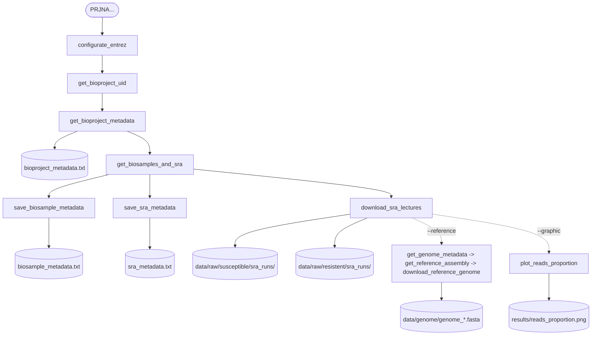

# Pipeline de la descarga de datos del Bioproject 

## Resumen 

Este módulo automatiza la consulta y descarga de datos asociados a un Bioproject de NCBI, a partir de un identificador (por ejemplo, PRJNA170440). 

El módulo realiza lo siguiente:

1. Configura NCBI Entrez con un email y API key. 
2. Descarga los metadatos del BioProject.
3. Obtiene los BioSamples y SRA asociados, y guarda sus metadatos.
4. Descarga las lecturas (FASTQ) de cada SRA y las clasifica por fenotipo (`susceptible` o `resistant`).
5. Opcionalmente, descarga el genoma de referencia del organismo.
6. Opcionalmente, genera un gráfico comparativo de proporción de lecturas
   entre los dos fenotipos.

**Todas las acciones se registran con marcas de tiempo en un archivo de log.**

## Requisitos 

-  Python 3.12
- Biopython (`Bio.Entrez`)
- Matplotlib (para el gráfico de proporción de lecturas)
- Conexión a internet

**Se recomienda ejecutar desde la raíz del proyecto, ya  (`docs/`, `data/`, `results/`, `logs/`).**

## Estructura de archivos generados 

analisis_expresion_malaria/
├── docs/
│ ├── bioproject_metadata.txt
│ ├── biosample_metadata.txt
│ ├── sra_metadata.txt
│ └── genome_metadata.txt
├── data/
│ ├── raw/
│ │ ├── susceptible/sra_runs/ # FASTQ de la cepa susceptible
│ │ └── resistent/sra_runs/ # FASTQ de la cepa resistente
│ └── genome/
│ └── genome_{organismo}.fasta
├── results/
│ └── reads_proportion.png
└── logs/
└── download_data.log

## Pipeline 



## Componentes clave 

### Utilidades de Entrez

`configurate_entrez(email, api_key)` — asigna `Entrez.email` y, si existe, `Entrez.api_key`. 
Lanza `ValueError` si no se proporciona email.

`get_bioproject_uid(bioproject_id)` — convierte un accession tipo `PRJNA...` al UID interno numérico mediante `esearch`. 
Es la base de todas las consultas posteriores.

### BioProject

`get_bioproject_metadata(bioproject_id, outdir="docs")` — obtiene el resumen del BioProject (`esummary`) y lo guarda en `docs/bioproject_metadata.txt`.

### BioSamples y SRA

`get_biosamples_and_sra(bioproject_id)` — devuelve dos listas: UIDs de
BioSamples y UIDs de SRA asociados al BioProject, usando `elink`. Imprime
ambas listas y registra los conteos en el log.

`save_biosample_metadata(biosample_ids, bioproject_id, outdir="docs")` —
guarda `Accession`, `Id`, `Title`, `Organism` y `ProjectAccession` de cada
BioSample en `docs/biosample_metadata.txt`.

`save_sra_metadata(sra_ids, bioproject_id, outdir="docs")` — guarda
`ExtId` (SRX), `Id`, `Title` y el accession del Run (SRR) extraído del XML
`Runs` de cada SRA en `docs/sra_metadata.txt`.

### Lecturas

`download_sra_lectures(bioproject_id, outdir="data/", w=8)` — para cada SRA:

1. Consulta `esummary(db="sra")`.
2. Extrae el fenotipo del campo `ExpXml` mediante regex.
3. Extrae los accessions de Run (`SRR`).
4. Ejecuta `fasterq-dump <SRR> -O <dir> --split-files -e <workers>`.

Las lecturas se almacenan en `data/raw/susceptible/sra_runs/` o
`data/raw/resistent/sra_runs/` según el fenotipo detectado. Si aparece un
fenotipo distinto, se crea `data/raw/<fenotipo>/sra_runs/`.

### Genoma de referencia

`get_reference_assembly(organism)` — busca en `db="assembly"` con el filtro
`"reference genome"[filter]` y devuelve el primer ensamblaje de referencia
como diccionario (`DocumentSummary`).

`get_genome_metadata(bioproject_id, outdir="docs/")` — guarda en
`docs/genome_metadata.txt` los campos:

- `AssemblyAccession`
- `AssemblyName`
- `AssemblyStatus`
- `Organism`
- `RefSeq_category`
- `FtpPath_RefSeq`
- `FtpPath_GenBank`

`download_reference_genome(bioproject_id, outdir="data/")` — usa
`FtpPath_RefSeq` (o `FtpPath_GenBank` como respaldo), construye la URL del
archivo `*_genomic.fna.gz`, lo descarga, lo descomprime y lo guarda como
`data/genome/genome_{organismo}.fasta`. Si el archivo ya existe, omite la
descarga.

### Análisis rápido

`count_reads(fastq_path)` — cuenta lecturas asumiendo 4 líneas por lectura.
Soporta `.fastq` y `.fastq.gz`.

`plot_reads_proportion(data_dir, outdir)` — cuenta lecturas de cada fenotipo
(solo archivos `_1` en caso de paired-end, para no duplicar) y genera
`results/reads_proportion.png` con la proporción por grupo.


## Uso por línea de comandos

### Argumentos

| Argumento | Requerido | Default | Descripción |
|---|---|---|---|
| `-p`, `--project` | Sí | — | BioProject ID (`PRJNA...`) |
| `-e`, `--email` | Sí | — | Email para NCBI Entrez |
| `-a`, `--api_key` | No | `None` | API key de NCBI |
| `-om`, `--outdirm` | No | `docs/` | Directorio de metadatos |
| `-od`, `--outdird` | No | `data/` | Directorio de datos |
| `--thr_fq` | No | `8` | Workers para `fasterq-dump` |
| `-r`, `--reference` / `--no-reference` | No | `True` | Descargar genoma |
| `-g`, `--graphic` / `--no-graphic` | No | `True` | Generar gráfico |
| `-v`, `--verbose` | No | `False` | Mensajes DEBUG |
| `--log_file` | No | `logs/download_data.log` | Ruta del log |

### Ejemplos

1. Ejecución mínima (metadatos + lecturas, sin genoma ni gráfico):

```bash
python src/download_data.py -p PRJNA170440 -e correo@ejemplo.com \ --no-reference --no-graphic
```

2. Ejecución completa 
```bash
python src/download_data.py -p PRJNA170440 -e correo@ejemplo.com -v
```